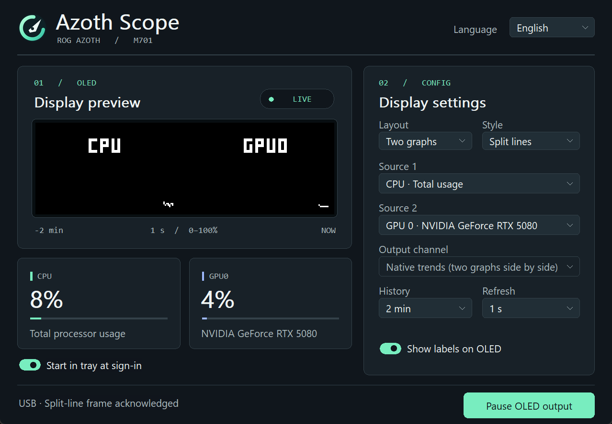

# Azoth Scope


把 Windows CPU、GPU 占用率画在初代 ROG 夜魔（Azoth M701）的 OLED 上。Rust 编写的便携托盘程序，自带设置和实时预览。默认每两秒采样一次，显示最近两分钟。使用 Windows 自带的 HID 驱动，不需要在 Armoury Crate 内导入文件。

## 开始使用



1. 将 `azoth-scope.exe` 放在固定目录，双击运行。首次启动只预览，不写键盘。
   在设置窗口右上角的 **Language** 选择 **简体中文** 或 **English**；界面、状态和托盘菜单立即切换，下次启动沿用所选语言。
2. 选「单图」或「双图」。每张图独立选 CPU 或某张显卡；默认上 CPU，下方选择专用显存最大的 GPU。两张显卡可各占一行。选中另一行正在用的指标会自动交换位置。
3. 检查预览，然后点 **开始写屏**。这会更新键盘的自定义图片槽；如果想保留当前素材，请先保留原文件。状态栏显示连接类型、确认或错误信息。指标缺失显示 `--%` 并在曲线上留空，不把缺失数据算成零。
4. 点 `×` 隐藏，双击通知区域图标重新打开；右键菜单可暂停、继续或退出。暂停停止后续上传，当前传输可能需要片刻收尾，屏幕可以停留在最后一帧。想恢复原显示，在 Armoury Crate 中重新应用即可。

默认不会登录自启。勾选设置中的「登录时启动到托盘」即可启用；移动 EXE 前先取消勾选。设置记在 `%LOCALAPPDATA%\AzothScope\settings.json`，包括上次是否在写屏。历史只保存在内存中，没有网络服务或传感器服务依赖。

右侧「显示设置」中可随时调整「历史时长」（1–30 分钟）和「刷新间隔」（1–30 秒），按整数选择后自动保存，无需暂停。历史时长决定横轴范围；刷新间隔决定多久读取一次新数据。运行期间最多保留最近 30 分钟的带时间戳采样；调整时长或间隔不会把已有点清空或错位。启动前没有采集的数据不会补算。键盘的原生频谱会在两次采样间维持当前画面，整图等通道的实际写屏速度仍受固件保护间隔及传输耗时限制。

## 设备和验证范围

| 环境 | 状态 |
| --- | --- |
| Windows 11 x64，初代 M701 有线 USB `0B05:1A83` | 本机实测整图、横幅均能刷新；两种模式均反馈约每两秒闪黑一次，暂停后稳定 |
| 2.4 GHz 独立接收器 `0B05:1A85` / OMNI `0B05:1ACE` | 已实现，待真机验证。OMNI 先查询配对信息，只选 M701 的控制报告 |
| 蓝牙 / Azoth Extreme / 其他键盘 | 不支持 |

CPU 来自 Windows 系统时间差值；显卡通过 DXGI 枚举，按 LUID 对应 Windows GPU Engine 性能计数器。对同一硬件引擎的各进程求和，再取每张卡最忙引擎的占用率。采样窗口、编号和取整可能与任务管理器不同，选卡请看型号。更换显卡或驱动后可重启程序重新枚举。

OLED 自绘区域为 208×64 灰阶像素；预览按两倍放大同一张画面。只写图片，不改按键、拨杆、固件或板载配置。连续更新自定义图片槽的耐久性与不同固件行为尚未验证。断开或设备休眠时预览仍工作，输出会自动重试。Armoury Crate 仍可使用；两个程序同时刷新 OLED 时可能互相覆盖，不会主动关闭华硕服务，也不保证某个程序永远拥有显示权。

### 第一次实机验收

原生趋势的「屏上显示名称」默认开启：双图分别在两侧标出对应的 `CPU`、`GPU0` 或 `GPU1`，单图居中。名称来自当前所选数据源，交换两张图后标签也会交换。

**原生趋势（Bar / Line）**：在「写屏」选「原生趋势」。若正在用整图或横幅，先暂停一次再换写屏方式。可在「图形」直接切换样式，保留已采集的历史：

- **Line · 分离折线**：按所选时间范围和真实采样时间独立绘制两侧曲线，中间留空，基线向上移 4 像素。通过媒体信息通道更新有变化的位图。本机 USB 已确认连续多帧的数据；可见刷新效果需以实物为准。
- **Bar · 柱状图 / Line · 原生连续**：键盘用频谱引擎绘图。单图 26 个点，双图每侧 12 个点，中央两点为零。固件会把原生连续折线的中央零点也连接起来。标签在连接或名称、样式变化时才更新。Bar 已经用户观察确认不闪。

各组最新时间在右侧，精确百分比在设置窗口显示。协议参考 [Omaglow 的 M701 频谱实现](https://github.com/peraltcant/omaglow/blob/main/src/protocol.cpp)。2.4 GHz 尚待实测。

**已知问题：** 在本机有线 M701 上，整图和横幅两种自绘通道均在刷新时闪黑，暂停后稳定。切换横幅未改善，不能视作修复。若遇到同样现象，暂停 Azoth Scope，可在 Armoury Crate 的 OLED「系统信息」中选单个实时指标作对照，观察读数变化时是否也闪黑。

本机原厂「系统信息」单独运行时不闪。在该模式下开启 Scope，两段各 12 秒的 USB 只读观测显示：同时运行时约每 2 秒收到一组整图应答（`61`），每 3 秒还有一条原厂指标应答（`66:00`）；暂停 Scope 后只剩 `66:00`。这表明两个来源同时更新，但不能单凭应答断定闪黑原因。可在 AC 切换到内置静态图并应用，再运行 Scope 作对照。开发者可用 `cargo run --locked --example observe_oled` 观察 12 秒的 OLED 命令应答计数（仅有线 M701）。

进一步对照：AC 改为内置城市烟花后，12 秒内只看到 6 组 Scope 图片上传、不再出现 `66:00`，物理屏仍闪黑。原厂指标争用不是本机出现该现象的必要条件。

排查偶尔闪回板载预设时，可在保持当前设置的情况下运行 `cargo run --example observe_oled -- --timeline 300`，并记下看到预设的时间。时间线用 UTC 记录预设选择应答、帧间隔、最后一包应答、固件拒绝或控制接口断开；不记录画面或按键。`67:02` 原生趋势数据通常没有逐帧应答，因此应答静默本身并不表示断线。

也可先执行 `cargo build --locked --example observe_oled`，再运行 `examples\mark-flash.ps1`。看到闪回时点击 **Saw the wallpaper**，标记和应答时间线以相同 UTC 时钟记录在 `target\oled-event-*.marks`、`.log` 和 `.err`。默认观察 10 分钟；关闭标记窗口即可提前停止。

- 保持 Armoury Crate 运行，先用 USB 在设置里选 CPU + GPU，开始写屏。确认物理屏上两个标签、百分比和线条方向与预览一致。观察至少两分钟，新点应在右侧，尽量区分「固件确认」与实际可见效果。
- 切换单图和双 GPU，暂停后重新应用 AC 画面；确认程序不会在暂停后抢回屏幕。
- 暂停、切到 2.4 GHz、继续，观察状态栏的连接方式与物理屏。报告问题时附连接方式、固件版本和状态文字即可。

## 从源代码构建

在 Windows 安装 stable Rust（MSVC 工具链）及 Visual Studio C++ Build Tools / Windows SDK，在本目录运行：

```powershell
cargo test --locked
cargo build --release --locked
.\target\release\azoth-scope.exe
```

要检查性能计数器和控制接口而不上传图片：`cargo run --locked -- --diagnose`。该命令在控制台打印设备和一次采样，OMNI 会使用只读配对查询。

GitHub Actions 配置见 `.github/workflows/windows.yml`，推送后构建可下载的 Windows x64 工作流产物。未使用 ASUS 官方 SDK，也不是 ASUS 官方软件。

## 参考与许可

OLED 帧协议及接收器通道信息参考 [M701 社区实测记录](https://github.com/awesomehy/rog-azoth-oled)。本项目以 Rust 独立实现，无需安装该项目或 Gear Link Companion。参见 [ASUS 官方 OLED 使用说明](https://rog.asus.com/us/support/faq/1050647/)。本项目代码采用 [MIT](LICENSE) 许可。
